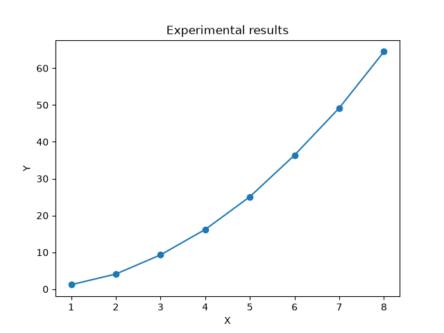

# Тестовая научная страница

## Введение

Данная страница используется для экспериментального сравнения
времени сборки и объёма результата генераторов статических сайтов.

Генератор получает исходный Markdown-документ и преобразует его
в набор статических HTML-файлов.

## Результаты

В эксперименте рассматриваются несколько значений параметра.

| Параметр | Значение |
|----------|---------:|
| A        |       10 |
| B        |       20 |
| C        |       30 |
| D        |       40 |

### График

<iframe
    src="assets/plotly_graph.html"
    width="100%"
    height="600"
    style="border: none;">
</iframe>

## Вывод

Полученные данные используются для сравнения эксплуатационных
характеристик генераторов статических сайтов.

Тестовое изменение №1.
Тестовое изменение №2.
Тестовое изменение №3.

Для проверки морфологии используются слова:
результат, результата, результаты, результатами.