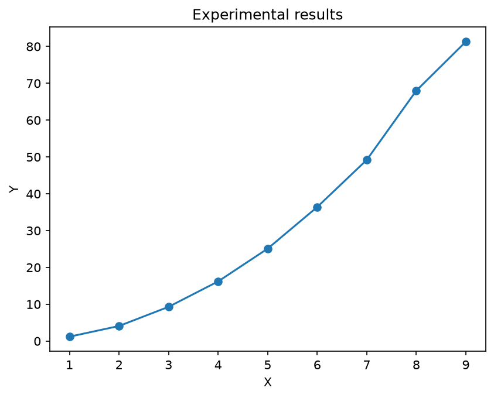

# Результаты эксперимента

## Описание

В рамках эксперимента был создан воспроизводимый pipeline:

Исходные данные находятся в файле `experiment.csv`.

Обработка выполняется автоматически с помощью Python-скрипта
`generate_results.py`.

## Полученный результат

Ниже представлен график зависимости значения `y` от параметра `x`.

<!-- BUILD-INFO-START -->

## Версия сборки

- Коммит: `01cd07f`
- Дата сборки (UTC): `2026-10-12T20:38:52Z`
- Данные `experiment.csv` (md5): `34c2edb596`

<!-- BUILD-INFO-END -->

