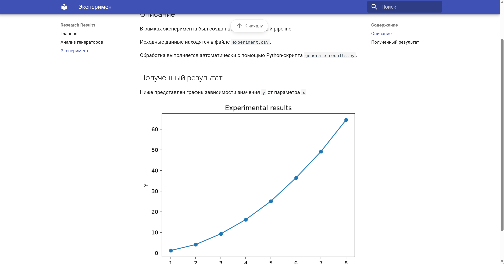
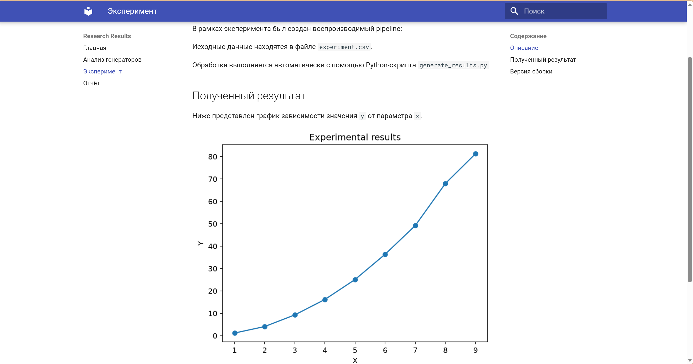
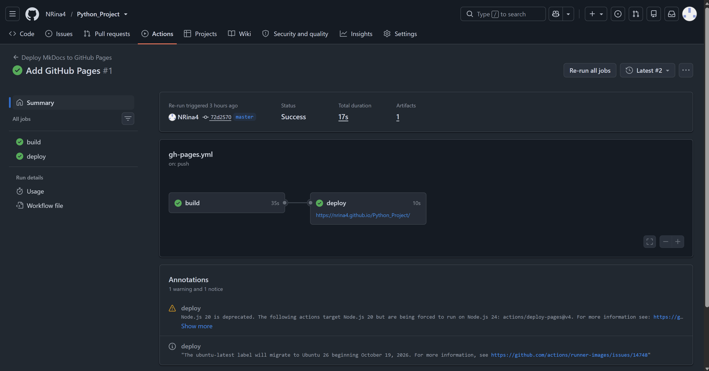
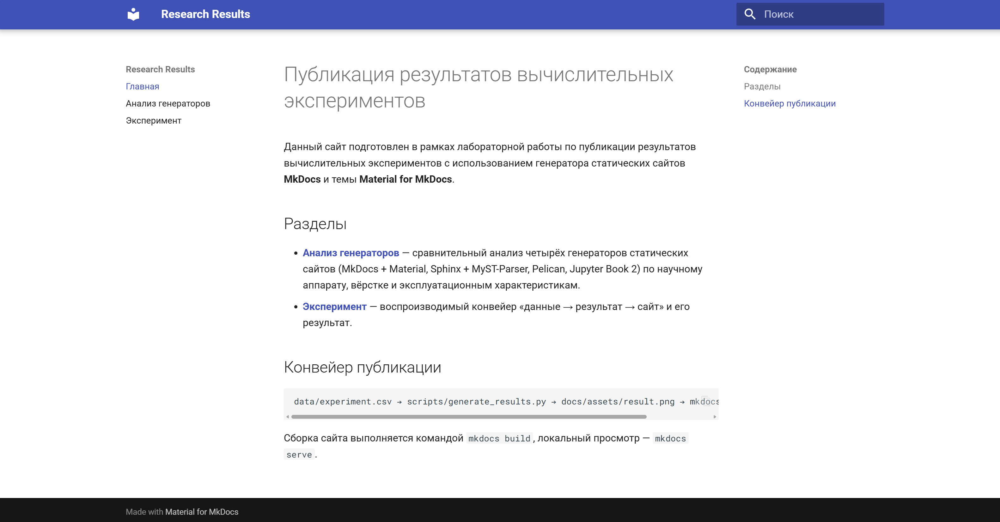
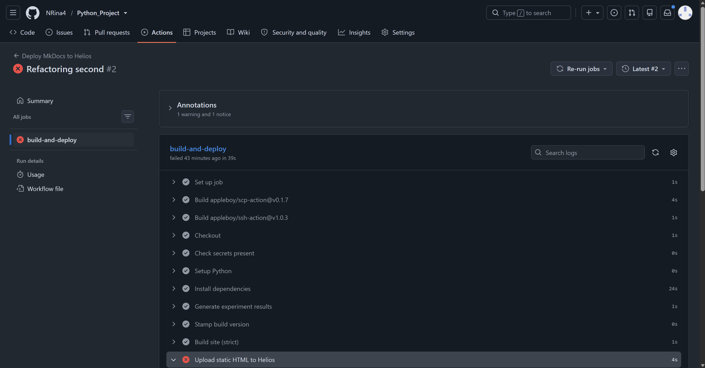
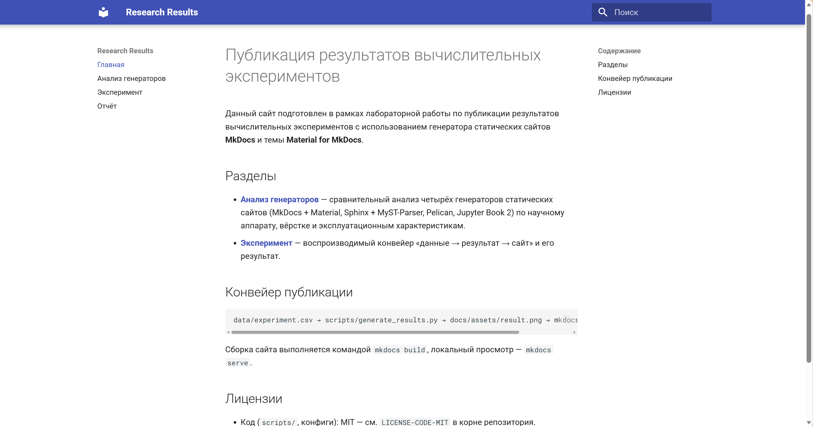
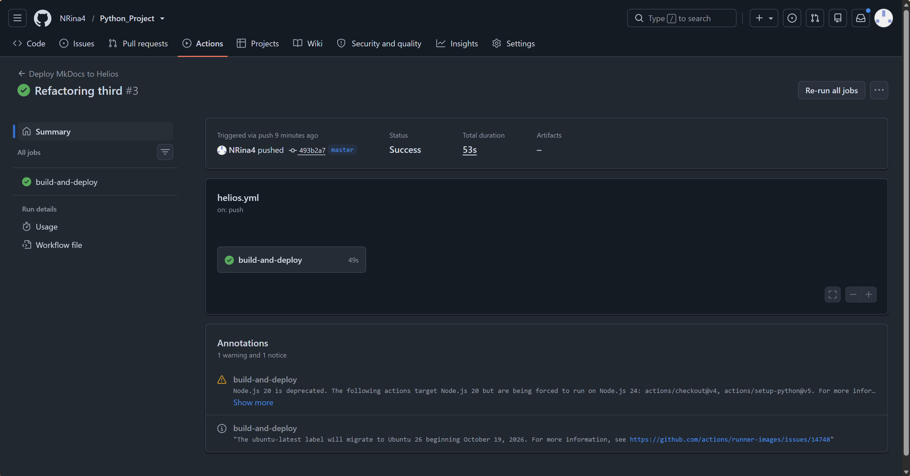

# Отчёт по заданию 3

## 1. Ход работы

1. Установлен Python 3.14.4, проверены `pip` и `virtualenv`, создано окружение `.venv/`.
2. Зависимости зафиксированы в `my-project/requirements.txt` точными версиями; кэш и сборка исключены через `.gitignore` (`venv`, `site/`, `_build/`, `.cache`).
3. Установлен MkDocs + Material, создан каркас сайта (`my-project/docs/`, `my-project/mkdocs.yml`).
4. Локальная проверка: `mkdocs serve` для предпросмотра, `mkdocs build --strict` для сборки.
5. Репозиторий инициализирован и отправлен на GitHub (`NRina4/Python_Project`, ветка `master`).
6. Настроен GitHub Actions (см. раздел 4), в `Settings → Pages → Source` выбрано `GitHub Actions`.
7. Использована официальная связка `upload-pages-artifact + deploy-pages` (разница со способом `push в gh-pages` — в разделе 4).
8. Отечественный хостинг: Helios, каталог `~/public_html/lab3`, URL `https://se.ifmo.ru/~s564883/lab3/` (адрес `helios.cs.ifmo.ru` ведёт туда же редиректом). Деплой — workflow `helios.yml` (см. раздел 4.3).
9. `site_url` задан через `!ENV [SITE_URL, ...]` (`my-project/mkdocs.yml:3`), `use_directory_urls: true`; для Helios-подкаталога `SITE_URL` переопределяется в workflow.
10. Проверка деплоя: HTTP-код, контрольная строка в HTML, поиск, формулы при недоступном CDN (см. раздел 6).
11. Лицензии: код — MIT (`LICENSE-CODE-MIT` в корне репозитория), контент — CC BY 4.0 (`LICENSE-CONTENT-CC-BY-4.0` в корне); упоминание на главной странице.
12. Отладка зафиксирована в разделе 7.

## 2. Теоретическое задание Т1

Выполнен сравнительный анализ четырёх генераторов: MkDocs + Material, Sphinx + MyST-Parser, Pelican, Jupyter Book 2.
Полный текст: [Анализ генераторов](research.md).

Итоговые взвешенные баллы (шкала 0–5, веса в сумме 100%):

| Генератор | Балл из 100 |
|---|---:|
| Sphinx + MyST-Parser | 93,8 |
| Jupyter Book 2 | 77,4 |
| MkDocs + Material | 72,0 |
| Pelican | 54,6 |

Вывод: по совокупности научных критериев оптимален Sphinx + MyST-Parser; для реализации конвейера в данной работе выбран MkDocs + Material (простота, быстрая сборка, русский поиск, работа в подкаталоге). Условия смены вывода — в `research.md`, раздел 9.

## 3. Практическое задание P3

Конвейер «данные → результат → сайт»:

```text
my-project/data/experiment.csv → scripts/generate_results.py → docs/assets/result.png → mkdocs build → сайт
```

Результат: [Эксперимент](experiment.md). Исходные данные меняются → `generate_results.py` пересчитывает график → push запускает CI → сайт обновляется.

Кэширование: повторный запуск без изменения `experiment.csv` пропускает пересчёт (`skip: up to date`).
Замер локально (Windows, Python 3.14.4): полный пересчёт после удаления `result.png` — 1,90 с; повтор с актуальным png — 1,46 с.
Выигрыш ~0,44 с (~23%); основное время в обоих случаях — старт интерпретатора и импорт matplotlib/pandas, на больших данных выигрыш будет больше.

Метка версии выводится внизу страницы эксперимента (`scripts/stamp_version.py` в CI перед сборкой): коммит, дата сборки UTC, md5 `experiment.csv`.

Демо воспроизводимости подтверждено: изменение `experiment.csv` (точка `8,64.5 → 8,68.0`, добавлена `9,81.3`) → push → CI пересобрал график → новый график виден на обоих хостингах.

До (старый график, 8 точек):



После (новый график, 9 точек):



## 4. Пайплайны

### 4.1. GitHub Pages (использован)

Workflow `.github/workflows/gh-pages.yml` (шаги прокомментированы в файле):
`checkout → setup-python 3.14 → pip install -r my-project/requirements.txt → generate_results.py → mkdocs build --strict (SITE_URL=https://nrina4.github.io/Python_Project/) → upload-pages-artifact (my-project/site) → deploy-pages`.

Полный текст:

```yaml
# Деплой основного сайта (my-project, MkDocs + Material) на GitHub Pages.
# Официальная связка: upload-pages-artifact + deploy-pages (Source = GitHub Actions).
# Альтернатива push в ветку gh-pages (peaceiris/actions-gh-pages) здесь не используется,
# разница описана в отчёте (deploy.md): gh-pages пушит готовый HTML в отдельную ветку,
# а официальный способ загружает артефакт и публикует его средствами Pages.
name: Deploy MkDocs to GitHub Pages

on:
  # Запуск при изменении сайта или самого workflow
  push:
    branches: [master]
    paths:
      - 'my-project/**'
      - '.github/workflows/gh-pages.yml'
  # Ручной запуск из вкладки Actions
  workflow_dispatch:

permissions:
  contents: read   # чтение репозитория
  pages: write     # публикация Pages
  id-token: write  # OIDC-токен для deploy-pages

# Один активный деплой за раз, очередь без отмены
concurrency:
  group: pages
  cancel-in-progress: false

jobs:
  build:
    runs-on: ubuntu-latest
    steps:
      # 1. Исходники
      - name: Checkout
        uses: actions/checkout@v4

      # 2. Python как в .venv (3.14)
      - name: Setup Python
        uses: actions/setup-python@v5
        with:
          python-version: '3.14'

      # 3. Зависимости с точными пинами
      - name: Install dependencies
        run: pip install -r my-project/requirements.txt

      # 4. P3: пересобрать график из данных (данные -> результат, с кэшированием)
      - name: Generate experiment results
        run: python my-project/scripts/generate_results.py

      # 4.1. P3: метка версии на странице эксперимента (коммит, дата, md5 данных)
      - name: Stamp build version
        run: python my-project/scripts/stamp_version.py

      # 5. Строгая сборка: битые ссылки = красный запуск (требование ТЗ)
      # SITE_URL задаёт канонический URL для Pages (корень репозитория-сайта)
      - name: Build site (strict)
        env:
          SITE_URL: 'https://nrina4.github.io/Python_Project/'
        run: mkdocs build --strict -f my-project/mkdocs.yml

      # 6. Упаковать готовый HTML для deploy-pages
      - name: Upload Pages artifact
        uses: actions/upload-pages-artifact@v3
        with:
          path: my-project/site

  deploy:
    needs: build
    runs-on: ubuntu-latest
    environment:
      name: github-pages
      url: ${{ steps.deployment.outputs.page_url }}
    steps:
      # 7. Публикация артефакта на GitHub Pages
      - name: Deploy to GitHub Pages
        id: deployment
        uses: actions/deploy-pages@v4
```

### 4.2. Push в `gh-pages` (peaceiris, не использован — для сравнения)

Готовый HTML коммитится ботом в отдельную ветку `gh-pages`, Pages отдаёт её (`Source = Deploy from a branch`). Плюсы: простота на старых репо. Минусы: мусорная ветка сборок, нужны права `contents: write`, конфликты при параллельных пушах. Официальный способ вместо ветки использует артефакт и OIDC (`pages: write, id-token: write`), поэтому выбран он.

### 4.3. Helios (Static HTML)

Workflow `.github/workflows/helios.yml`: сборка та же (`generate_results.py` → `stamp_version.py` → `mkdocs build --strict` с `SITE_URL` из Variables), дальше `appleboy/scp-action` кладёт `site/` в `~/public_html/$HELIOS_DIR` и `appleboy/ssh-action` выставляет права `755/644`. Аутентификация — по SSH-ключу (`HELIOS_KEY`), персональные данные только в Secrets/Variables, в файлах их нет. Логин/пароль/пути из репозитория удалены сознательно (см. ошибку №2).

Полный текст:

```yaml
# Деплой того же сайта (my-project) на Helios (факультетский сервер ИТМО).
# Роль «Static HTML»: готовый статик из my-project/site/ загружается в каталог
# пользовательских страниц на сервере.
# Персональные данные (логин, ключ, путь) в репозитории НЕ хранятся, только ссылки:
#   Secrets (Settings -> Secrets and variables -> Actions -> Secrets):
#     HELIOS_USER - логин, HELIOS_KEY - приватный SSH-ключ (в репозитории не хранится).
#   Variables (та же страница, вкладка Variables):
#     HELIOS_SITE_URL - базовый URL подкаталога со слэшем на конце,
#     HELIOS_DIR - имя каталога в ~/public_html (например, lab3).
name: Deploy MkDocs to Helios

on:
  # Те же условия, что у gh-pages.yml: оба сайта обновляются одним push
  push:
    branches: [master]
    paths:
      - 'my-project/**'
      - '.github/workflows/helios.yml'
  workflow_dispatch:

# Загрузка по scp меняет файлы на сервере, параллельные запуски запрещаем
concurrency:
  group: helios
  cancel-in-progress: false

jobs:
  build-and-deploy:
    runs-on: ubuntu-latest
    steps:
      # 1. Исходники
      - name: Checkout
        uses: actions/checkout@v4

      # 2. Python как в .venv (3.14)
      - name: Setup Python
        uses: actions/setup-python@v5
        with:
          python-version: '3.14'

      # 3. Зависимости с точными пинами
      - name: Install dependencies
        run: pip install -r my-project/requirements.txt

      # 4. P3: пересобрать график из данных (с кэшированием)
      - name: Generate experiment results
        run: python my-project/scripts/generate_results.py

      # 4.1. P3: метка версии на странице эксперимента
      - name: Stamp build version
        run: python my-project/scripts/stamp_version.py

      # 5. Строгая сборка с базовым URL подкаталога Helios (иначе тут типичная
      # ошибка ТЗ: в подкаталоге ломаются абсолютные пути; у нас относительные).
      # URL берётся из Variables, в файле его нет.
      - name: Build site (strict)
        env:
          SITE_URL: ${{ vars.HELIOS_SITE_URL }}
        run: mkdocs build --strict -f my-project/mkdocs.yml

      # 6. Загрузка готового HTML в каталог пользовательских страниц по scp (порт 2222).
      # Аутентификация — по SSH-ключу (секрет HELIOS_KEY): парольный метод сервер
      # не предлагает (см. ошибку attempted methods [none]), вручную ssh работает
      # за счёт keyboard-interactive, которого у scp-клиента нет.
      # strip_components=2 срезает префикс my-project/site, чтобы файлы легли
      # в корень каталога, а не во вложенную папку.
      - name: Upload static HTML to Helios
        uses: appleboy/scp-action@v0.1.7
        with:
          host: helios.cs.ifmo.ru
          port: 2222
          username: ${{ secrets.HELIOS_USER }}
          key: ${{ secrets.HELIOS_KEY }}
          source: 'my-project/site/*'
          target: '~/public_html/${{ vars.HELIOS_DIR }}'
          strip_components: 2

      # 7. Права для Apache: каталоги 755, файлы 644 (иначе 403 Forbidden).
      - name: Fix permissions on Helios
        uses: appleboy/ssh-action@v1.0.3
        with:
          host: helios.cs.ifmo.ru
          port: 2222
          username: ${{ secrets.HELIOS_USER }}
          key: ${{ secrets.HELIOS_KEY }}
          script: |
            find ~/public_html/${{ vars.HELIOS_DIR }} -type d -exec chmod 755 {} \;
            find ~/public_html/${{ vars.HELIOS_DIR }} -type f -exec chmod 644 {} \;
```

## 5. Ссылки

- Репозиторий: `https://github.com/NRina4/Python_Project`
- GitHub Pages: `https://nrina4.github.io/Python_Project/`
- Отечественный хостинг (Helios): `https://se.ifmo.ru/~s564883/lab3/`

## 6. Измерения (только таблицами)

| Замер | Значение |
|---|---|
| Время `mkdocs build --strict` локально (Windows) | 0,62 с |
| Время `mkdocs build --strict` (лог Actions) | входит в длительность workflow (46 с / 53 с), отдельно не замерялось |
| Размер `my-project/site` | 3 255 309 Б (≈ 3,10 MiB) |
| Размер `docs/assets/result.png` | 30 878 Б (≈ 30,2 KiB) |
| Размер `docs/assets/actions-success.png` | 185 072 Б (≈ 180,7 KiB) |
| Размер `docs/assets/pages-site.png` | 202 325 Б (≈ 197,6 KiB) |
| Длительность workflow Pages (Actions) | 46 с |
| Длительность workflow Helios (Actions) | 53 с |
| Размер `docs/assets/experiment-before.png` | 211 022 Б (≈ 206,1 KiB) |
| Размер `docs/assets/experiment-after.png` | 218 938 Б (≈ 213,8 KiB) |
| Размер `docs/assets/helios-site.png` | 222 935 Б (≈ 217,7 KiB) |
| Размер `docs/assets/helios-actions.png` | 177 426 Б (≈ 173,3 KiB) |
| Размер `docs/assets/actions-failed.png` | 170 136 Б (≈ 166,1 KiB) |
| Время холодной/инкрементальной сборки 4 генераторов | см. `research.md`, раздел 4 |
| Стоимость Plotly (до/после) | см. `research.md`, раздел 6 |











## 7. Отладка

### Ошибка 1. Deploy 404 — Pages не включён
- Текст: `Failed to create deployment (status: 404) ... Ensure GitHub Pages has been enabled`.
- Гипотеза: `deploy-pages` некуда публиковать, `Source` не переключён на Actions.
- Проверка: открыли `settings/pages`, артефакт в логе при этом найден (`artifact_id ...`).
- Решение: `Settings → Pages → Source = GitHub Actions`, затем `Re-run failed jobs`. Повторный запуск зелёный.

### Ошибка 2. Helios: `ssh: handshake failed ... attempted methods [none]`
- Текст ошибки: шаг `appleboy/scp-action` падал с `error copy file to dest: helios.cs.ifmo.ru ... ssh: handshake failed: ssh: unable to authenticate, attempted methods [none], no supported methods remain`.
- Гипотеза 1 (не подтвердилась): секреты не доходят до раннера. Проверка: временный шаг `test -n "${{ secrets.HELIOS_USER }}"` вывел `secrets present` — логин и пароль на месте, гипотеза отвергнута.
- Гипотеза 2 (подтвердилась): сервер не предлагает парольную аутентификацию, а scp-клиент (Go) умеет только её. Ручной `ssh` при этом работал — за счёт `keyboard-interactive`, которого у клиента экшена нет. Дополнительное подтверждение: вход по SSH-ключу заработал сразу после добавления ключа в `authorized_keys`.
- Решение: заведён отдельный деплой-ключ ed25519 без парольной фразы; публичный добавлен в `~/.ssh/authorized_keys`, приватный положен в секрет `HELIOS_KEY`; оба шага workflow переключены с `password:` на `key:`; персональный логин убран из файлов в Secrets/Variables. Повторный запуск зелёный, сайт на Helios обновился. Временный диагностический шаг из workflow удалён.

### Ошибка 3. `build --strict` падает на битой ссылке
- Текст ошибки: `WARNING - Doc file 'report.md' contains a link 'nonexistent-page.md', but the target is not found among documentation files. Aborted with 1 warnings in strict mode!`
- Гипотеза: в строгом режиме любое предупреждение — это ошибка сборки; ссылка ведёт на несуществующую страницу.
- Проверка: запущен `mkdocs build --strict` локально — сборка прервана с тем же предупреждением; поиск по файлу нашёл строку со ссылкой.
- Решение: ссылка удалена, повторная сборка зелёная (`Documentation built`). Вывод для CI: именно поэтому в workflow используется `--strict`, а не обычный `build`.

## 8. Вывод

Рекомендуемый стек для публикации результатов в данной предметной области: Sphinx + MyST-Parser для полного научного аппарата; MkDocs + Material — при приоритете простоты и публикации уже посчитанных результатов отдельным pipeline (реализовано здесь); Jupyter Book 2 — при исполняемых ноутбуках в сборке; Pelican — для контентных сайтов без научной типографики. Ограничения, меняющие рекомендацию, — в `research.md`, раздел 9.
